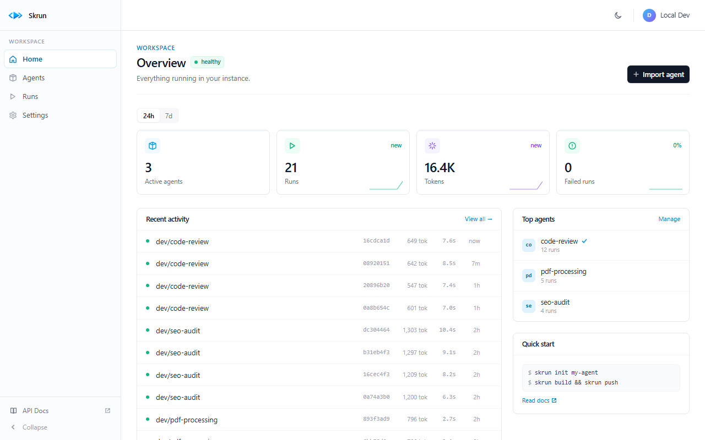
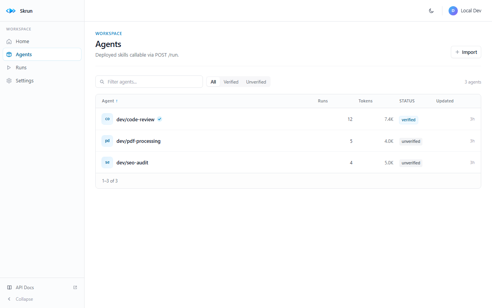
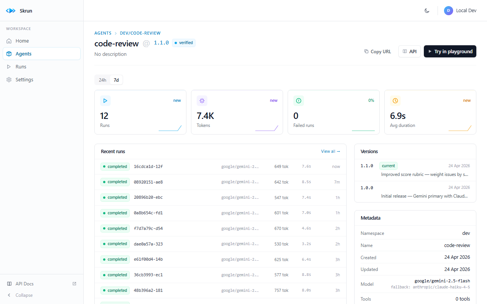
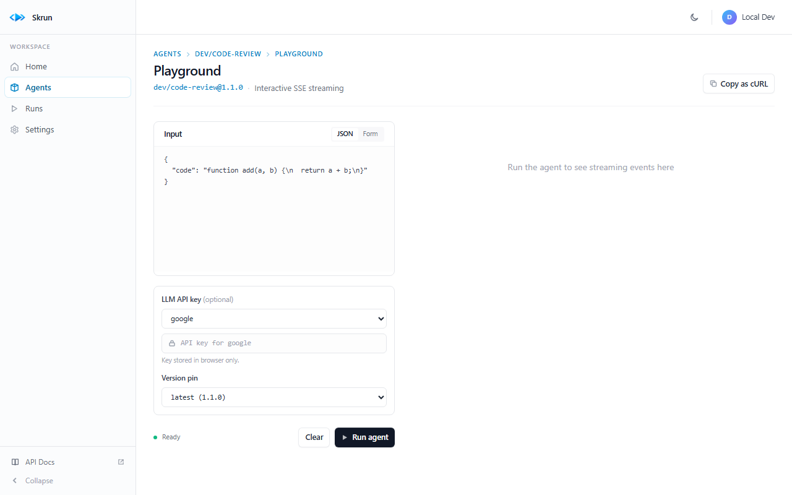
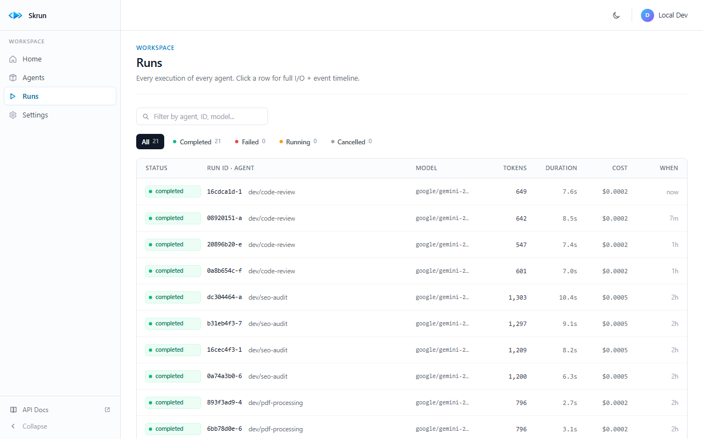
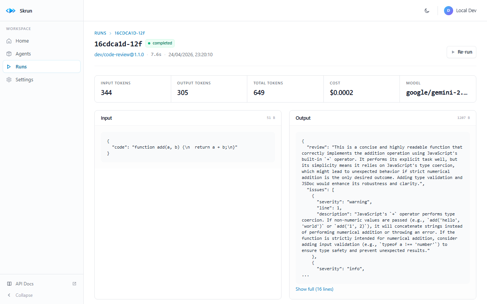
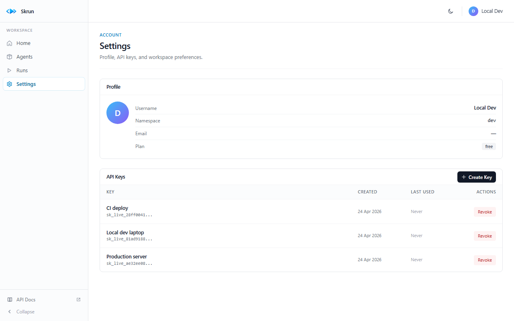

# Getting Started

A 10-minute walkthrough: install Skrun, build your first agent, explore the dashboard, and call your agent from code.

> → New to Skrun? Read [Concepts](./concepts.md) first for the vocabulary (agent, skill, run, namespace…).
> → Deploying to production? Jump to [Self-hosting](./self-hosting.md) when you're done.

---

## Prerequisites

- **Node.js ≥ 22.19** and **pnpm ≥ 9** (or npm/yarn — the CLI works with any, pnpm is the recommended one)
- A terminal and a text editor
- Optional: one LLM API key (Google Gemini has a free tier and is used by all demo agents — grab one at [aistudio.google.com](https://aistudio.google.com/apikey))

Verify:

```bash
node --version   # v22.19+ required
pnpm --version   # 9+ recommended
```

---

## 1. Install the CLI

```bash
npm install -g @skrun-dev/cli
```

Verify:

```bash
skrun --version
```

---

## 2. Create your first agent

Scaffold a new agent:

```bash
skrun init my-agent
cd my-agent
```

This creates three files:

- `SKILL.md` — the instructions your agent follows. This is the "brain". Edit it to describe what the agent does and how it should behave.
- `agent.yaml` — the runtime config. Declares the LLM, inputs/outputs, environment, tests. See the [full reference](./agent-yaml.md).
- `scripts/` (optional) — local tools the agent can call. Any language that reads stdin and writes stdout.

Open `SKILL.md` and `agent.yaml` in your editor. For this tutorial we'll keep the defaults — a simple echo agent that returns the input.

The model `skrun init` preselects is Google's `gemini-3.8-flash`, so the Google key of the prerequisites is the one this tutorial uses. Pick another model at the prompt, or pass `--model <provider/name>`, to run on another provider's key.

> **Importing an existing skill?** Use `skrun init --from-skill ./my-existing-skill` instead. Skrun copies the SKILL.md and wraps it with a default `agent.yaml` — see [Concepts → Skill](./concepts.md#skill).

---

## 3. Iterate locally with `skrun dev`

```bash
skrun dev
```

Starts a local HTTP server on port 3000 with a mock LLM — no real calls, no cost. POST to it while you iterate on `SKILL.md`:

```bash
curl -X POST http://localhost:3000/run \
  -H "Content-Type: application/json" \
  -d '{"input": {"query": "hello"}}'
```

The file watcher auto-reloads on changes to `SKILL.md` and `agent.yaml`. Useful for shaping the prompt and trying a client that posts to `/run` (curl, a frontend) before spending LLM tokens; the SDK's `client.run()` and `skrun run` call a deployed agent's run route and read its event stream, which this server does not serve. What it checks of a request: [`skrun dev`](cli.md#skrun-dev).

---

## 4. Check your tests with `skrun test`

`agent.yaml` can declare inline tests — in place of the `tests: []` line `skrun init` wrote:

```yaml
tests:
  - name: basic
    input:
      query: "hello"
    assert: output.result != null
```

Run them — no model key is needed:

```bash
skrun test
```

```
ℹ Running 1 test(s) for my-agent...
ℹ Outputs are simulated — no model is called. Each test checks that its input carries each input the agent requires — null, or an empty list for a file input, counts as missing —, then its assertion against placeholder outputs. For a real run: skrun deploy, then skrun run.
✓ basic (output.result != null)

✓ 1 passed, 0 failed
```

`skrun test` checks each test's input and its assertion against placeholder outputs — `"mock_value"` for the `result` string here —, so `output.result != null` always passes: it says nothing of what the model answers. Use it to catch a test whose input misses a required field, or an assertion that does not read. The agent meets a model in section 7, once it is deployed.

---

## 5. Deploy your agent

Start a local registry in a second terminal, at the root of a clone of the Skrun repository, installed and built (`git clone https://github.com/skrun-dev/skrun.git`, then `pnpm install && pnpm build` in it). The registry is what calls the model when your agent runs (section 7), so give it your key first: `pnpm dev:registry` loads the `.env` file at the repository's root — it needs one, which `cp .env.example .env` creates — and a variable exported in that terminal wins over the file.

```bash
cp .env.example .env    # once; then add GOOGLE_API_KEY=your_key_here to .env (Google free tier recommended)
# or, for this terminal only: export GOOGLE_API_KEY=your_key_here

pnpm dev:registry
```

The registry runs on `http://localhost:4000` and uses SQLite by default (persistent, no setup needed — see [Concepts → Namespace](./concepts.md#namespace)).

Login and deploy:

```bash
skrun login --token dev-token
skrun deploy -m "Initial release"
```

`deploy` runs the full pipeline: build → push → print the run URL. The `-m` flag attaches a note to this version (like a git commit message) — you'll see it later in the dashboard.

Output, under the local registry's default verification policy (`admin`, and `dev-token` is an admin):

```
✓ Pushed dev/my-agent@1.0.0
⚠ New agents start unverified. Run `skrun verify dev/my-agent@1.0.0` before it can be called — you are an admin on this server.

  🚀 Deployed. Your agent's endpoint, once the version can be called (see above):

  POST http://localhost:4000/api/agents/dev/my-agent/run
  Auth: Bearer <your-token>

  Once the version can be called (see above), try it — save this input as input.json:
    {"query":"hello"}
  then run:
    skrun run dev/my-agent -f input.json
  or, in bash or zsh:
    skrun run dev/my-agent -i '{"query":"hello"}'
```

Once `skrun verify dev/my-agent@1.0.0` has run (section 7), either line calls the agent: the `-f` one in any shell, the `-i` one in bash or zsh. They carry no token and no address — `skrun run` uses the CLI's session. On a server whose policy is `owner` or `disabled`, the version can be called at once, and `deploy` says the agent is live.

---

## 6. Explore the dashboard

Open `http://localhost:4000/dashboard` in your browser.



The **Home** page shows workspace-wide stats (active agents, runs today, tokens, failed runs) with 24h/7d toggles, the account's usage of the server's run quotas — runs in progress, compute, fast starts — when it sets them, a recent activity feed, top agents by volume, and a quick-start card.

### Agents list



The **Agents** page lists every deployed agent with run counts, token usage, and verification status. Filter by name, sort by any column.

### Agent detail



Click an agent to see its **Agent detail** page. Key sections:

- **Stats strip** — runs, tokens, failed, avg duration (24h or 7d).
- **Recent runs** — last 10 runs with model, tokens, duration, cost, status.
- **Versions** — every version with its note (the `-m` message you attached at push time). Click a version to target it specifically.
- **Metadata** — namespace, name, model (with fallback), tools, timeout, created/updated.
- **Try it** — inline curl snippet + link to the playground.

### Playground



The **Playground** lets you call the agent interactively. JSON editor (or generated form), LLM key input (the key stays in the page's memory only: it is kept while you move between dashboard pages, and gone on a reload or a sign-out), version pin, and a Run button that opens an SSE stream. You see the events in real-time and the final result below.

For agents that accept file inputs (audio, PDF, images), switch to **Form** mode at the top of the Input panel — each file input gets its own attach button that uploads to the unified files namespace and substitutes the right `file_id` reference into the request. JSON mode is also available, but it expects you to wire the `file_id` references by hand; the playground will show a hint in JSON mode reminding you to use Form mode for file agents. The bundled demo agents under `agents/<name>/fixtures/` ship sample files (`sample-receipts/`, `sample-vault/`, `sample.wav`, …) that the Form-mode auto-fill can attach in one click.

### Runs + run detail



The **Runs** page lists every execution across all agents, filterable by agent, ID, or model. Status chips let you jump to failed/running/cancelled.



Click a run to see its **Run detail** — tokens, cost, model, duration, full input and output JSON, and the event timeline (tool calls, LLM calls, completion). Useful for debugging.

### Settings



**Settings** — your profile (username, namespace, email, plan) and API keys (`skrun_sk_…` for production) with one-shot reveal, revocation, and last-used timestamps. Creating a key offers an expiration (90 days preselected, "No expiration" as an explicit choice) and the list shows when each key expires. A key minted by `skrun login` instead takes the instance's own default lifetime — 90 days unless the operator changed it.

---

## 7. Call your agent from code

### CLI (recommended for quick checks)

```bash
# Verify the pushed version first — every push lands at verified=false
# (admin gate). In local dev with dev-token, you're auto-admin.
skrun verify dev/my-agent@1.0.0

# Then invoke
skrun run dev/my-agent -i '{"query": "hello from code"}'
```

The CLI handles auth from your `skrun login` session and prints the response JSON to stdout (pipe to `jq`, save to a file, whatever).

### curl

```bash
# Same call via raw HTTP — the verify step above is still required.
curl -X POST http://localhost:4000/api/agents/dev/my-agent/run \
  -H "Authorization: Bearer dev-token" \
  -H "Content-Type: application/json" \
  -d '{"input": {"query": "hello from code"}}'
```

### TypeScript SDK

```bash
npm install @skrun-dev/sdk
```

```ts
import { SkrunClient } from "@skrun-dev/sdk";

const client = new SkrunClient({
  baseUrl: "http://localhost:4000",
  token: "dev-token",
});

// Sync
const result = await client.run("dev/my-agent", { query: "hello" });
console.log(result.output);

// Inspect cost + caching info — `cache_read_tokens` is populated when the
// provider served part of the prompt from its cache (typically on the 2nd+
// call with a stable system prompt + tools). 30-90% input cost savings are
// already reflected in `cost.estimated`; `cost.saved` reports the dollar
// value of those savings (omitted when 0).
console.log("Tokens:", result.usage.prompt_tokens, "+", result.usage.completion_tokens);
if (result.usage.cache_read_tokens) {
  console.log("Cache hit:", result.usage.cache_read_tokens, "tokens (billed at cached rate)");
}
console.log("Cost: $" + result.cost.estimated.toFixed(6));
if (result.cost.saved) {
  console.log("Saved: $" + result.cost.saved.toFixed(6));
}

// Stream
for await (const event of client.stream("dev/my-agent", { query: "hello" })) {
  console.log(event.type, event);
}

// Async with webhook
const { run_id } = await client.runAsync(
  "dev/my-agent",
  { query: "hello" },
  "https://your-app.com/callback",
);
```

See the [SDK README](https://www.npmjs.com/package/@skrun-dev/sdk) for all 9 methods.

---

## 8. Vision quickstart — pass images to your agent

Agents can declare `file`-typed inputs (image / PDF / audio) that the LLM reads directly via its native multimodal capability. The shipped [`receipts-to-expenses`](../agents/receipts-to-expenses/) demo is a good 2-minute walk-through.

```bash
cd agents/receipts-to-expenses
skrun build && skrun push
skrun verify dev/receipts-to-expenses@0.5.1   # admin step — auto-admin in dev-token mode
```

(The agent declares `requirements.txt` at its bundle root — the local registry resolves `openpyxl` + `reportlab` + `pandas` automatically on its first call and caches them on this machine, at `~/.skrun/deps/<hash>/`. No manual `pip install` needed. See [Script dependencies](agent-yaml.md#script-dependencies).)

Call it via the SDK with `Blob` inputs — uploads happen automatically:

```ts
import { SkrunClient } from "@skrun-dev/sdk";
import { readFileSync } from "node:fs";

const client = new SkrunClient({ baseUrl: "http://localhost:4000", token: "dev-token" });

const result = await client.run("dev/receipts-to-expenses", {
  receipts: [
    new Blob([readFileSync("./fixtures/sample-receipts/01-restaurant.jpg")], { type: "image/jpeg" }),
    new Blob([readFileSync("./fixtures/sample-receipts/02-uber.jpg")], { type: "image/jpeg" }),
    new Blob([readFileSync("./fixtures/sample-receipts/03-saas.jpg")], { type: "image/jpeg" }),
  ],
  month: "2026-04",
});

console.log(result.output.total_amount);  // → e.g. 156.30
console.log(result.output.expenses_xlsx_path);  // → "expenses.xlsx" (in run output dir)
```

Or via raw curl — upload first, then reference by `file_id`:

```bash
RECEIPT_1=$(curl -s -X POST http://localhost:4000/api/files \
  -H "Authorization: Bearer dev-token" \
  -F "file=@./fixtures/sample-receipts/01-restaurant.jpg" | jq -r .file_id)

curl -X POST http://localhost:4000/api/agents/dev/receipts-to-expenses/run \
  -H "Authorization: Bearer dev-token" \
  -H "Content-Type: application/json" \
  -d "{\"input\": {\"receipts\": [{\"type\":\"file\",\"source\":\"id\",\"file_id\":\"$RECEIPT_1\"}], \"month\":\"2026-04\"}}"
```

To declare your own multimodal agent, add a `file`-typed input to `agent.yaml`:

```yaml
inputs:
  - name: photo
    type: file
    media: image
    mime_types: [image/jpeg, image/png, image/webp]
    max_size: 5_000_000
    required: true
```

See [`agent.yaml` → File inputs](./agent-yaml.md#inputs-required) for full details and [API → Uploading input files](./api.md#uploading-input-files) for the wire format.

---

## What's next

- **Ship to production** — [Self-hosting guide](./self-hosting.md) (OAuth, Postgres, reverse proxy) or use the managed cloud at `skrun.sh` — see its [quick start](https://skrun.sh/docs/quickstart).
- **Build a stateful agent** — see [Concepts → State](./concepts.md#state) and the [`meeting-transcript-to-action-items`](../agents/meeting-transcript-to-action-items/) example, which maintains an open-actions ledger across runs (run after each meeting and prior actions auto-resolve when next transcript mentions them as done).
- **Produce downloadable artifacts** — see the [`csv-to-executive-report`](../agents/csv-to-executive-report/) example which turns a CSV into a multi-page PDF with charts, or [`knowledge-base-from-vault`](../agents/knowledge-base-from-vault/) which bundles a Markdown vault into a navigable HTML site as a `.zip` artifact.
- **Add MCP tools** — connect to Slack, GitHub, a headless browser, etc. See [Concepts → MCP](./concepts.md#mcp) and the [`web-scraper` example](../agents/web-scraper/).
- **Pin a specific version** — for reproducible integrations, pass `{ version: "1.2.0" }` in the POST /run body. See [API → Run an agent](./api.md#run-an-agent).
- **Deep dive on config** — [`agent.yaml` reference](./agent-yaml.md) documents every field.
